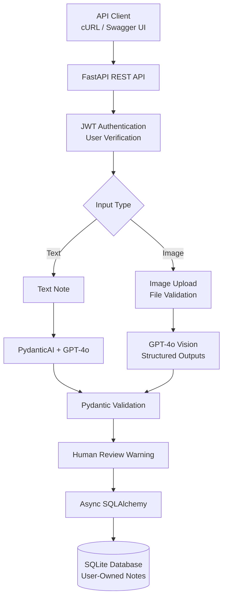

# Clinical AI — Clinical Note Extraction API

**AI-Powered Clinical Documentation | FastAPI | GPT-4o | Python**

Clinical AI is an AI-powered backend application that extracts structured information from clinical notes and uploaded images using OpenAI GPT-4o.

Built with **FastAPI, PydanticAI, SQLAlchemy, and JWT authentication**, the application demonstrates secure REST API development, structured AI outputs, asynchronous database operations, and automated testing.

The backend has been verified through **22 automated tests**, GitHub Actions CI, and live GPT-4o integration tests using synthetic clinical notes.

## Disclaimer

Clinical AI is a software engineering prototype intended for
demonstration using synthetic clinical data. AI-generated outputs
require human review and are not intended for clinical diagnosis,
treatment, or patient-care decisions.


## Key Features

- **AI-Powered Clinical Note Extraction** — Extract diagnoses, medications, dosage details, and follow-up instructions from typed clinical notes.
- **Image-Based Note Processing** — Analyze uploaded JPEG, PNG, and WebP clinical-note images using GPT-4o vision.
- **Structured AI Responses** — Pydantic models validate extracted fields, urgency classifications, and confidence values.
- **JWT Authentication** — Account registration, password hashing, token-based authentication, and database-backed user verification.
- **Account-Level Data Isolation** — Users can access only notes associated with their authenticated accounts.
- **Secure Image Uploads** — File-type validation, content verification, 5 MiB upload limits, and image dimension safeguards.
- **Asynchronous Persistence** — SQLAlchemy ORM with SQLite for local development.
- **Error Handling** — Sanitized error responses for common AI API and output-validation failures.
- **Automated Testing & CI** — Pytest test suite and GitHub Actions workflow.

## System Architecture



### Processing Workflow

1. A user registers or authenticates through the REST API.
2. FastAPI validates the JWT and verifies the associated user account.
3. The user submits a typed clinical note or supported image.
4. GPT-4o extracts structured information through PydanticAI or the OpenAI SDK.
5. Pydantic validates the returned diagnoses, medications, follow-ups, urgency, and confidence.
6. A human-review warning is attached to the extraction.
7. SQLAlchemy stores the result with account ownership, allowing only authorized retrieval.

## Technology Stack

| Category | Technologies |
|---|---|
| Backend | Python, FastAPI, Uvicorn |
| Generative AI | OpenAI GPT-4o, PydanticAI |
| Data Validation | Pydantic v2, Pillow |
| Authentication | JWT, bcrypt, OAuth2 |
| Database | SQLite, SQLAlchemy, aiosqlite |
| Testing | Pytest, HTTPX, FastAPI TestClient |
| CI/CD | GitHub Actions |

## Project Structure

```text
clinical-ai/
├── .github/
│   └── workflows/
│       └── ci.yml
├── app/
│   ├── agent.py
│   ├── database.py
│   ├── image_validation.py
│   ├── main.py
│   ├── models.py
│   ├── security.py
│   └── routers/
│       ├── auth.py
│       └── notes.py
├── tests/
│   ├── test_agent_validation.py
│   ├── test_ai_errors.py
│   ├── test_image_validation.py
│   └── test_note_security.py
├── .gitignore
├── requirements.txt
├── requirements-dev.txt
└── README.md
```

## Getting Started

### Prerequisites

- Python 3.13
- OpenAI API key with access to GPT-4o
- Git

### 1. Clone the Repository

```bash
git clone https://github.com/SayojyaPatil/clinical-ai.git
cd clinical-ai
```

### 2. Create a Virtual Environment

```bash
python3 -m venv venv
source venv/bin/activate
```

### 3. Install Dependencies

```bash
python -m pip install -r requirements.txt
```

For development and testing:

```bash
python -m pip install -r requirements-dev.txt
```

### 4. Configure Environment Variables

Create a `.env` file in the project root:

```dotenv
OPENAI_API_KEY=your_openai_api_key
SECRET_KEY=your_random_jwt_signing_secret
```

Generate a signing secret with:

```bash
python -c 'import secrets; print(secrets.token_urlsafe(48))'
```

Use the generated value for `SECRET_KEY`.

Never commit your `.env` file or expose API credentials.

### 5. Start the Backend

```bash
python -m uvicorn app.main:app --reload
```

The application runs at:

- API: http://127.0.0.1:8000
- Swagger UI: http://127.0.0.1:8000/docs
- Health Check: http://127.0.0.1:8000/health

The local SQLite database is initialized on application startup.

## API Endpoints

| Method | Endpoint | Description | Authentication |
|---|---|---|---|
| GET | `/health` | Check application health | No |
| POST | `/auth/signup` | Register a user | No |
| POST | `/auth/token` | Authenticate and receive JWT | No |
| POST | `/notes/analyze-text` | Extract and store structured clinical data | Yes |
| POST | `/notes/analyze-image` | Analyze and store clinical-note images | Yes |
| GET | `/notes` | Retrieve authenticated user's notes | Yes |
| GET | `/notes/{note_id}` | Retrieve a specific authorized note | Yes |

### Example: Register a User

```bash
curl -X POST http://127.0.0.1:8000/auth/signup \
  -H "Content-Type: application/json" \
  -d '{
    "username": "demo_user",
    "password": "LocalDemoPassword2026!"
  }'
```

### Example: Authenticate

```bash
TOKEN=$(
  curl -fsS -X POST http://127.0.0.1:8000/auth/token \
    -H "Content-Type: application/x-www-form-urlencoded" \
    --data-urlencode 'username=demo_user' \
    --data-urlencode 'password=LocalDemoPassword2026!' \
  | python3 -c 'import json,sys; print(json.load(sys.stdin)["access_token"])'
)
```

### Example: Analyze a Clinical Note

```bash
curl -X POST http://127.0.0.1:8000/notes/analyze-text \
  -H "Authorization: Bearer $TOKEN" \
  -H "Content-Type: application/json" \
  -d '{
    "patient_id": "DEMO-001",
    "note_text": "Fictional patient presents for routine follow-up. Assessment: seasonal allergic rhinitis. Medication: cetirizine 10 mg once daily. Follow up in four weeks if symptoms persist."
  }'
```

### Example Response

```json
{
  "id": "generated-uuid",
  "patient_id": "DEMO-001",
  "diagnoses": "seasonal allergic rhinitis",
  "medications": "cetirizine 10 mg once daily",
  "follow_ups": "Follow up in four weeks if symptoms persist",
  "urgency": "routine",
  "confidence": 0.99,
  "warning": "AI-generated extraction. Clinical review required before use.",
  "created_at": "2026-10-23T17:50:41"
}
```

*Example output is illustrative. The exact wording and confidence score may vary.*

### Retrieve Clinical Notes

```bash
curl http://127.0.0.1:8000/notes \
  -H "Authorization: Bearer $TOKEN"
```

To upload a synthetic note image:

```bash
curl -X POST \
  "http://127.0.0.1:8000/notes/analyze-image?patient_id=DEMO-002" \
  -H "Authorization: Bearer $TOKEN" \
  -F "file=@synthetic-note.png;type=image/png"
```

Live GPT-4o API requests may incur usage charges.

## Testing & Continuous Integration

Clinical AI includes **22 automated tests** covering authentication, authorization, image validation, structured AI outputs, and error handling.

| Test Suite | Coverage | Tests |
|---|---|---:|
| `test_note_security.py` | JWT authentication, user isolation, note ownership | 7 |
| `test_image_validation.py` | Upload size, file types, corrupted content | 5 |
| `test_agent_validation.py` | Urgency, confidence, and schema validation | 8 |
| `test_ai_errors.py` | AI failure handling and data integrity | 2 |
| **Total** | | **22** |

### Run Tests

```bash
SECRET_KEY=local-test-only-secret-key python -m pytest -v
```

**Verified locally: 22 tests passed.**

The automated tests use mocked AI responses and isolated temporary SQLite databases. They do not make OpenAI API calls.

### GitHub Actions

The repository includes a GitHub Actions CI workflow that performs dependency installation, Python syntax checks, and automated tests on pushes and pull requests.

[View GitHub Actions](https://github.com/SayojyaPatil/clinical-ai/actions)

### Live Integration Verification

In addition to automated testing, manual integration tests using synthetic data successfully verified:

- GPT-4o extraction from typed clinical notes
- GPT-4o vision extraction from a machine-printed note image
- JWT-based authentication through FastAPI
- Structured response generation and validation
- SQLite persistence and authorized note retrieval
- Patient ID filtering

These tests demonstrate functional integration, not clinically validated accuracy. Handwritten-note accuracy has not yet been independently evaluated.

## Security

Clinical AI implements several backend security controls:

- JWT authentication with token expiration and database-backed account verification
- Account-level authorization and ownership-based note retrieval
- Password hashing using bcrypt
- Image content validation and file-size restrictions
- Sanitized error responses for common AI failures
- Environment-based credential management
- Human-review warnings for AI-generated extractions


## Author

**Sayojya Patil**
